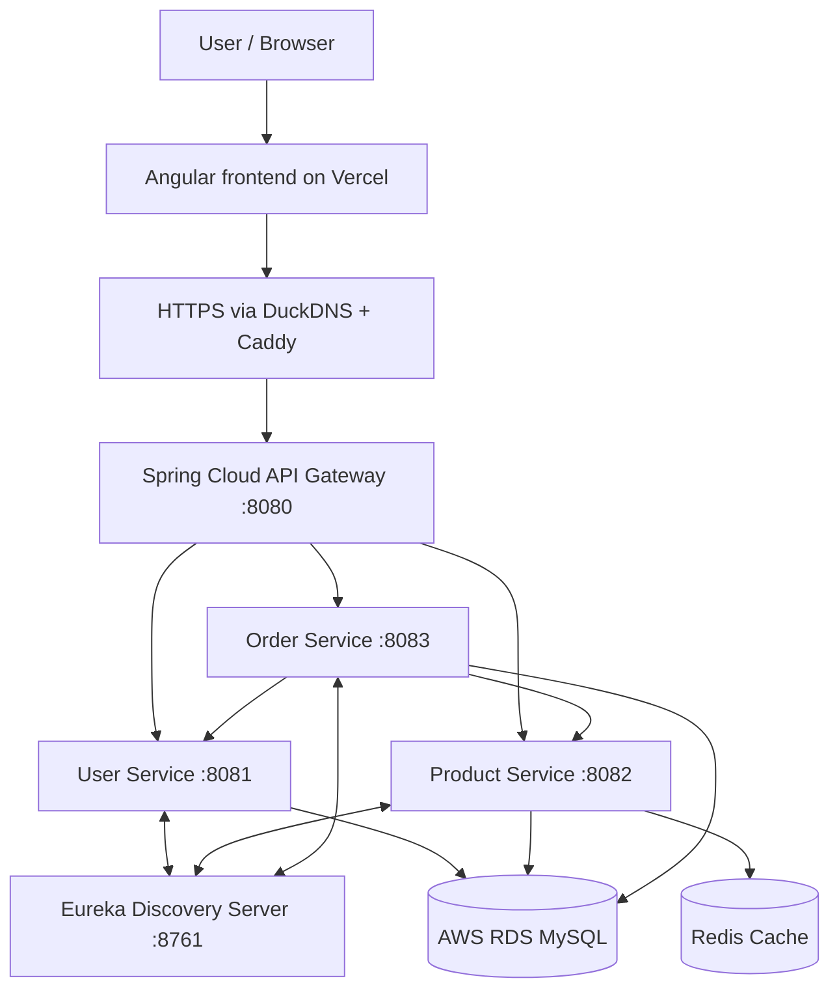
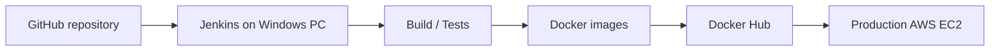

ShopEase — Full-Stack E-Commerce Microservices
A full-stack e-commerce application built with Spring Boot microservices and an Angular frontend, containerized with Docker and deployed on AWS. ShopEase demonstrates service discovery, API gateway routing, authentication, order management, Redis caching, relational persistence, and CI/CD with Jenkins.
Live application
- Frontend: https://shopease-woad-one.vercel.app/
- Backend API: https://harsha-shopease-api.duckdns.org/
- Source code: https://github.com/HarshaEgiteela/microservices
The public deployment depends on cloud infrastructure being online. Some operations require an authenticated account.

Features
- User registration, login, and account/profile management
- Product browsing and product administration
- Shopping cart and checkout/order workflows
- Saved delivery addresses
- Role-based access to protected endpoints
- Redis-backed product caching, with cache invalidation when product data changes
- Independent Spring Boot services registered with Eureka
- Centralized routing through Spring Cloud Gateway
- Dockerized deployment with Docker Compose
- Jenkins pipeline for building and deploying backend services
Technology stack
Layer	Technologies
Frontend	Angular, TypeScript
Backend	Java, Spring Boot, Spring Security, Spring Data JPA
Microservices	Spring Cloud Gateway, Netflix Eureka, REST APIs
Authentication	Spring Security, JWT
Database	MySQL on Amazon RDS
Caching	Redis, Spring Cache
Containerization	Docker, Docker Compose
CI/CD	Jenkins (Windows-hosted), GitHub, Docker Hub
Hosting	Amazon EC2, Amazon RDS, Vercel
HTTPS / reverse proxy	Caddy, DuckDNS
Testing	JUnit, Mockito, Testcontainers (where configured)

Architecture

The diagram is a conceptual overview. Each service uses its own logical database (userdb, productdb, and orderdb) on the RDS MySQL instance.
Backend services
Service	Default local port	Responsibility
Eureka Server	8761	Service registration and discovery
API Gateway	8080	Single entry point and routing
User Service	8081	Accounts, authentication, profiles, addresses
Product Service	8082	Product catalog and administration
Order Service	8083	Orders, carts, and related workflows

Key engineering concepts
Service discovery and API gateway
Backend services register with Eureka. The gateway routes requests to the appropriate service, allowing the Angular client to communicate through one backend entry point instead of calling each service directly.
Authentication and authorization
The application uses JWT-based authentication with Spring Security. Protected endpoints enforce authentication and role-based permissions where applicable.
Redis caching
Frequently requested product data is cached using Spring Cache + Redis to reduce repeated database reads. Product-modifying operations invalidate relevant cached entries so subsequent reads can fetch updated data.
Persistence
Services use Spring Data JPA with MySQL. The deployed environment uses Amazon RDS rather than a database running inside the application EC2 instance.
Deployment architecture
- Angular frontend: hosted on Vercel.
- Backend: Docker containers running on an Amazon EC2 instance.
- Database: Amazon RDS for MySQL.
- Cache: Redis container alongside the backend services.
- Public HTTPS: Caddy reverse proxy with a DuckDNS hostname.
- Images: published to Docker Hub under harshaegiteela.
CI/CD with Jenkins
The project uses a Windows-hosted Jenkins installation and a repository Jenkinsfile for backend CI/CD. The workflow can build and test Spring Boot services, build and push Docker images, and deploy updated containers to the production EC2 instance over SSH.

Operational note: Jenkins runs on the developer's Windows PC, not on a dedicated AWS Jenkins server. Manual builds are available when the PC and Jenkins are running. Any webhook-triggered automation also requires the local Jenkins server to be reachable; this is not an always-on cloud CI/CD setup.

Running locally
Prerequisites
- Java and Maven versions compatible with the project's Spring Boot services
- Docker Engine / Docker Desktop with Docker Compose
- MySQL (local or hosted) and the required databases
- Node.js and Angular CLI for frontend development
Clone
git clone https://github.com/HarshaEgiteela/microservices.git
cd microservices
Configure environment
Provide the required database connection values, authentication secrets, and other service-specific settings through environment variables or local configuration. Do not commit passwords, JWT secrets, database credentials, or SSH private keys.

For local MySQL, create the logical databases used by the services:
CREATE DATABASE IF NOT EXISTS userdb;
CREATE DATABASE IF NOT EXISTS productdb;
CREATE DATABASE IF NOT EXISTS orderdb;
Start backend containers
From the directory containing your Compose file:
docker compose up -d --build
Check status and logs:
docker compose ps
docker compose logs -f
The API gateway normally listens on http://localhost:8080, and Eureka on http://localhost:8761, subject to your Compose configuration.
Start the Angular frontend
In the frontend project directory (if cloned separately, open that repository first):
npm install
ng serve
Configure the frontend's API base URL to point to the local API gateway for local development.
Testing
Run the relevant service tests from its directory:
./mvnw test
On Windows PowerShell, use ./mvnw.cmd test if the Maven wrapper is present, or mvn test when Maven is installed. Some integration tests may require Docker to run Testcontainers.
Example API routes
Routes below illustrate the gateway's service prefixes; exact methods and authentication requirements depend on the controllers.
/users/**
/products/**
/orders/**
Repository and deployment notes
This repository contains the backend microservices and related deployment/pipeline configuration. The Angular frontend may be maintained in a separate project directory or repository.

Production credentials are supplied outside source control. For your own deployment, update domain names, Docker image names, database settings, and Jenkins credentials to match your environment.
Author
E Harsha
GitHub: HarshaEgiteela
