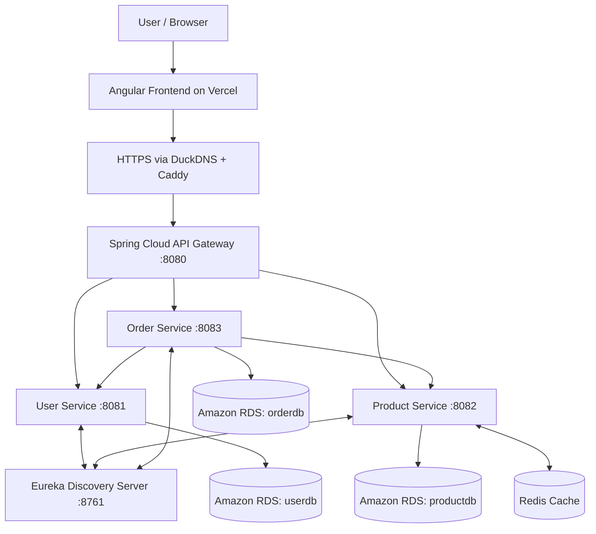
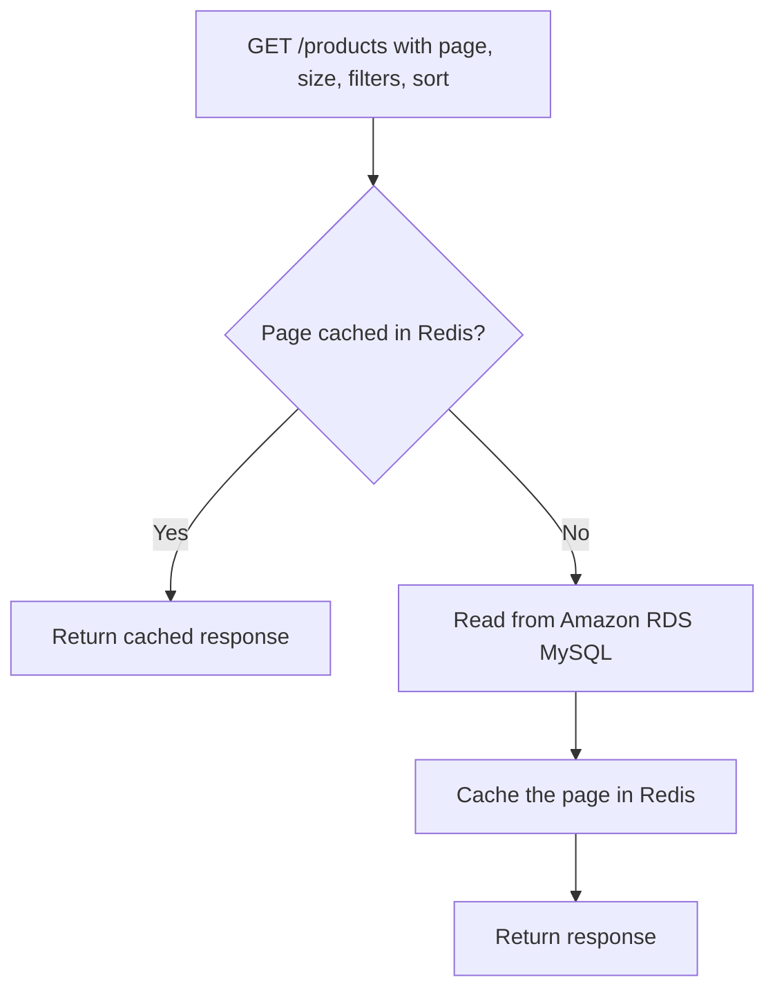
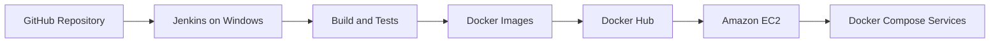

# 🛒 ShopEase — Full-Stack E-Commerce Microservices

A full-stack e-commerce application built with **Spring Boot microservices**, an **Angular** frontend, **Docker**, **Redis**, and **AWS**. ShopEase demonstrates service discovery, centralized API routing, JWT authentication, role-based authorization, shopping carts and orders, database persistence, caching, and Jenkins-based CI/CD.

The Angular frontend is deployed on **Vercel**. Backend services run as Docker containers on **Amazon EC2**, with persistent data in **Amazon RDS MySQL**.

## 🌐 Live Application

| Resource | Link |
|---|---|
| Frontend | [ShopEase on Vercel](https://shopease-woad-one.vercel.app/) |
| Backend API | [ShopEase API](https://harsha-shopease-api.duckdns.org/) |
| Source code | [HarshaEgiteela/microservices](https://github.com/HarshaEgiteela/microservices) |

> **Availability:** The public deployment depends on the AWS infrastructure being online. Some operations require an authenticated account or administrator role.

## ✨ Features

- User registration, login, and profile management
- JWT authentication and role-based access to protected endpoints
- Saved delivery addresses
- Product browsing, pagination, filtering, sorting, and administration
- Shopping cart, checkout, and order workflows
- Redis-backed product-page caching with expiration and cache invalidation on product updates
- Independent Spring Boot services registered with Netflix Eureka
- Centralized routing through Spring Cloud Gateway
- Dockerized deployment with Docker Compose
- Jenkins pipeline for backend builds and deployment
- HTTPS access using Caddy and DuckDNS

## 🛠 Technology Stack

| Layer | Technologies |
|---|---|
| Frontend | Angular, TypeScript |
| Backend | Java, Spring Boot, Spring Data JPA |
| Security | Spring Security, JWT |
| Microservices | Spring Cloud Gateway, Netflix Eureka, REST APIs |
| Database | MySQL on Amazon RDS |
| Caching | Redis, Spring Cache |
| Containerization | Docker, Docker Compose |
| CI/CD | Jenkins (Windows-hosted), GitHub, Docker Hub |
| Hosting | Amazon EC2, Amazon RDS, Vercel |
| HTTPS / reverse proxy | Caddy, DuckDNS |
| Testing | JUnit, Mockito, Testcontainers (where configured) |

## 🏗 Architecture



The diagram is a conceptual overview. The backend containers run on Amazon EC2. Each service uses its own **logical database** (`userdb`, `productdb`, or `orderdb`) on the same Amazon RDS MySQL instance.

### Backend Services

| Service | Default port | Responsibility |
|---|---:|---|
| Eureka Server | 8761 | Service registration and discovery |
| API Gateway | 8080 | Single entry point and request routing |
| User Service | 8081 | Accounts, authentication, profiles, addresses |
| Product Service | 8082 | Catalog, product management, pagination, inventory |
| Order Service | 8083 | Carts, checkout, orders |

### Service Discovery and Gateway

Services register with Eureka, and Spring Cloud Gateway routes frontend requests to the appropriate backend service.

```text
/users/**     → User Service
/products/**  → Product Service
/orders/**    → Order Service
```

## 🔐 Authentication and Authorization

ShopEase uses Spring Security and JWT-based authentication. After login, authenticated requests carry a token that the backend validates. Protected endpoints enforce authentication and role-based permissions where applicable.

## 🗄 Database and Product Catalog

Persistent application data is stored in **Amazon RDS MySQL**, not in the EC2 container filesystem.

| Database | Primary data |
|---|---|
| `userdb` | Users, authentication, saved addresses |
| `productdb` | Products, categories, prices, stock, image URLs |
| `orderdb` | Orders, order items, carts, cart items |

The current deployed catalog contains **200 active products**. Product records include fields such as `id`, `name`, `description`, `price`, `quantity`, `active`, `category`, and `image_url`.

Product images are referenced through URLs stored in MySQL. The current catalog uses Wikimedia Commons image URLs; images have been observed displaying in the frontend, although individual image accuracy and long-term availability are not guaranteed.

## ⚡ Redis Caching

The Product Service uses **Spring Cache + Redis** to cache requested product pages and reduce repeated reads from MySQL.



### Pagination-Aware Cache Keys

Examples observed on the deployed Redis instance:

```text
activeProducts::null,null,null,null,name_asc,0,12
activeProducts::null,null,null,null,name_asc,1,12
activeProducts::null,null,null,null,name_asc,2,12
```

These represent distinct requests for pages 0, 1, and 2, each with a page size of 12, sorted by name ascending. Redis caches **requested pages**, not automatically the nearest or adjacent pages.

### Expiration and Invalidation

- Product-page cache entries have a **5-minute (300-second) TTL**.
- Expired entries are reloaded from MySQL on a subsequent request.
- Product-modifying operations are configured to invalidate relevant cached entries.

### Verified Cache Hits

Two repeated requests were made through the API Gateway:

```bash
curl -s -o /dev/null "http://localhost:8080/products?page=0&size=12"
curl -s -o /dev/null "http://localhost:8080/products?page=0&size=12"
```

Redis counters changed as follows:

| Metric | Before | After | Change |
|---|---:|---:|---:|
| Cache hits | 22 | 24 | +2 |
| Cache misses | 24 | 24 | 0 |

This is consistent with both requests being served from an existing cached page, assuming no other Redis clients affected the counters during the test.

To inspect the cache on EC2:

```bash
docker exec redis redis-cli --scan --pattern 'activeProducts::*'
docker exec redis redis-cli INFO stats | grep -E 'keyspace_hits|keyspace_misses'
```

## ☁️ Production Deployment

- **Frontend:** Angular application hosted on Vercel.
- **Backend:** Dockerized Spring Boot services on Amazon EC2.
- **Database:** Amazon RDS for MySQL, with separate logical databases per service.
- **Cache:** Redis Docker container running alongside the backend.
- **Container images:** Published to Docker Hub under `harshaegiteela`.
- **HTTPS:** Caddy reverse proxy with the DuckDNS hostname `harsha-shopease-api.duckdns.org`.

## 🔄 CI/CD with Jenkins

The repository uses a **Windows-hosted Jenkins** installation and a Jenkinsfile for backend CI/CD.



The pipeline can build and test Spring Boot services, build and push Docker images, and deploy updated containers to EC2 over SSH.

> **Operational note:** Jenkins runs on the developer's Windows PC, not an always-on cloud server. Manual builds are available while Jenkins is running. Webhook-triggered automation also requires Jenkins to be reachable.

## 💻 Running Locally

### Prerequisites

- Java and Maven versions compatible with the Spring Boot services
- Docker Engine / Docker Desktop with Docker Compose
- MySQL (local or hosted)
- Node.js, npm, and Angular CLI for the frontend

### 1. Clone the Backend Repository

```bash
git clone https://github.com/HarshaEgiteela/microservices.git
cd microservices
```

### 2. Configure the Databases

For local MySQL, create the logical databases:

```sql
CREATE DATABASE IF NOT EXISTS userdb;
CREATE DATABASE IF NOT EXISTS productdb;
CREATE DATABASE IF NOT EXISTS orderdb;
```

Provide database connection details, JWT secrets, and other required configuration through environment variables or local configuration files.

> **Security:** Never commit database passwords, JWT secrets, SSH private keys, or other production credentials. Inside Docker containers, `localhost` refers to the container itself; use a database hostname reachable from the container.

### 3. Start the Backend

From the directory containing the Compose file:

```bash
docker compose up -d --build
docker compose ps
docker compose logs -f
```

Default local endpoints (subject to Compose configuration):

- API Gateway: `http://localhost:8080`
- Eureka: `http://localhost:8761`

### 4. Start the Angular Frontend

From the frontend project directory (which may be maintained separately):

```bash
npm install
ng serve
```

Set the frontend API base URL to your local gateway for development.

## 🧪 Testing

Run service tests from the relevant service directory:

```bash
./mvnw test
```

On Windows PowerShell:

```powershell
.\mvnw.cmd test
```

Or use `mvn test` if Maven is installed. Some integration tests may require Docker for Testcontainers.

### Example API Request

```bash
curl "http://localhost:8080/products?page=0&size=12"
```

Example gateway route prefixes (exact methods and permissions depend on controllers):

```text
/users/**
/products/**
/orders/**
```

## 📚 Engineering Concepts Demonstrated

- Microservices and service discovery
- API Gateway routing
- REST API design
- JWT authentication and role-based authorization
- Spring Data JPA and relational persistence
- Logical database separation by service
- Redis cache-aside behavior, TTL, and invalidation
- Pagination, filtering, and sorting
- Docker containerization and Docker Compose
- Amazon EC2 and RDS integration
- HTTPS reverse proxy configuration
- Jenkins-based build and deployment automation

## 🚀 Future Improvements

- Host curated, appropriately licensed product images in Amazon S3
- Improve product-image accuracy and attribution
- Explore Amazon ECS for container orchestration
- Consider always-on cloud CI/CD or GitHub Actions
- Add centralized logging, metrics, and alerting
- Expand automated integration and end-to-end tests

## 👨‍💻 Author

**E Harsha**  
GitHub: [HarshaEgiteela](https://github.com/HarshaEgiteela)  
Repository: [ShopEase Microservices](https://github.com/HarshaEgiteela/microservices)
